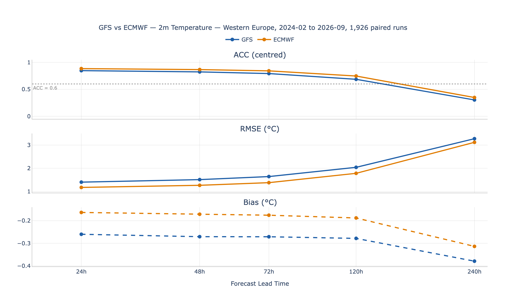
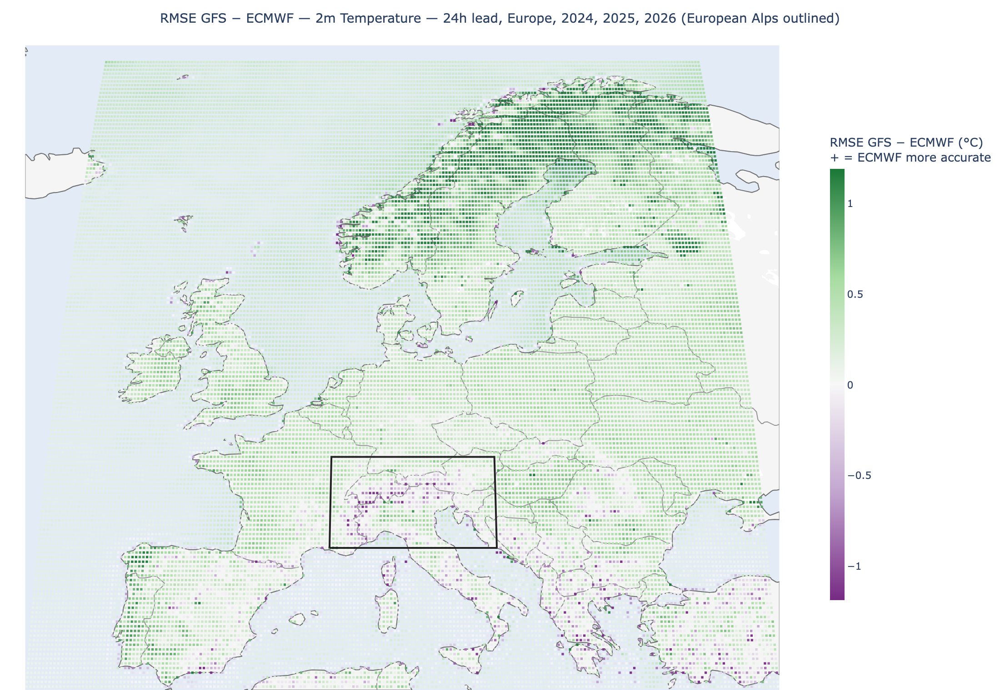

# wx-verify

**Verification of operational weather forecasts (GFS and ECMWF IFS) against ERA5 reanalysis over Europe and western North America, with a focus on mountain regions.**

> **Live dashboard:** https://wx-verify-uvv947uunr9zlvzg6bp5mx.streamlit.app/

wx-verify measures how accurate two global forecast models are, how that accuracy falls off with forecast lead time, how the two models compare on identical forecasts, and how GFS skill differs between 2016 and today. It fetches archived forecasts and ERA5 reanalysis, reduces them to monthly sufficient statistics, and serves the results through an interactive Streamlit dashboard.

---

## What is verified

| | |
|---|---|
| **Models** | NOAA GFS (00z and 12z runs) · ECMWF IFS HRES (00z and 12z runs, open data) |
| **Truth** | ERA5 reanalysis, 0.25° |
| **Lead times** | 24, 48, 72, 120, 240 h |
| **Variables** | 2 m temperature · mean sea level pressure · 500 hPa geopotential height · 10 m wind speed · freezing level (GFS only) · 24 h precipitation · snow water equivalent (GFS only) |
| **Domains** | Europe (35–72°N, 15°W–35°E) · western North America (36–62°N, 140–102°W) |
| **Regions** | Western Europe, UK & Ireland, Scandinavia, Mediterranean, Central Europe, Iberian Peninsula, European Alps, Norwegian Mountains · Pacific Northwest, Western Canada, Rockies |

**Periods (forecast initialisation dates)**

- GFS: 2016-01-01 → 2016-12-31 and 2021-03-01 → 2026-09-20. There is no data for 2017-01 → 2021-02; the dashboard never draws a line across the gap.
- GFS snow water equivalent: 2021-03-23 → 2026-09-20 only.
- ECMWF: 2024-02-01 → 2026-09-20 (the period in which ECMWF open data is at 0.25°).

---

## Method

**Scores.** Bias, RMSE and anomaly correlation coefficient (ACC) for continuous variables; frequency bias and equitable threat score (ETS) at 1, 5 and 10 mm for 24 h precipitation. Freezing level and snow water equivalent get bias and RMSE only.

**ACC.** Anomalies are taken against an ERA5 1991–2020 climatology by calendar month and hour of day. Skill curves and metric cards use spatial ACC (computed per forecast over the region, then averaged over forecasts), centred form. Maps use temporal ACC at each grid point.

**Area weighting and pooling.** Region scores are weighted by cos(latitude) and pooled over all grid points and forecasts (RMSE is the square root of the pooled mean squared error).

**Homogeneous samples.** A forecast run is included only if every lead time has both forecast and ERA5 data, so every point on a skill curve uses the same forecasts. GFS vs ECMWF comparisons use only runs available for both models.

**Exact valid-time matching.** Forecasts are compared with ERA5 at their exact valid time, on the ERA5 0.25° grid.

**Storage.** For every grid point, lead time and month the pipeline stores sufficient statistics (count, Σe, Σe², and the anomaly sums needed for ACC; contingency counts for precipitation), so scores for any month window are exact sums rather than averages of averages. Region tables are committed to the repo (2.7 MB); per-year grid-point map files are hosted as GitHub Release assets and downloaded by the dashboard on first use.

---

## Headline results

All numbers below are computed from the committed region tables.

**GFS 2 m temperature, Western Europe** (2021-03 → 2026-09, 4,057 runs)

| Lead | 24 h | 48 h | 72 h | 120 h | 240 h |
|---|---|---|---|---|---|
| RMSE (°C) | 1.41 | 1.51 | 1.64 | 2.03 | 3.26 |
| ACC (centred) | 0.84 | 0.82 | 0.79 | 0.69 | 0.31 |

ACC stays above the conventional 0.6 usefulness line at 120 h and is well below it at 240 h. Over the same period the European Alps 24 h RMSE is 1.94 °C.

**GFS vs ECMWF, paired** (2024-02 → 2026-09, the same 1,926 runs for both)

| | GFS | ECMWF |
|---|---|---|
| 2 m temperature, Western Europe, 24 h RMSE | 1.40 °C | 1.18 °C |
| 2 m temperature, European Alps, 24 h RMSE | 1.89 °C | 1.88 °C |
| 500 hPa height, Western Europe, 120 h ACC | 0.875 | 0.909 |
| Mean sea level pressure, Western Europe, 24 h RMSE | 0.81 hPa | 0.58 hPa |



*2 m temperature over Western Europe: centred ACC, RMSE and bias against lead time for GFS and ECMWF on the same 1,926 runs (2024-02 → 2026-09). The dotted line is ACC = 0.6.*

ECMWF's advantage in 2 m temperature over Western Europe largely disappears in the Alps.



*Grid-point 24 h RMSE of GFS minus that of ECMWF for 2 m temperature, over the paired runs (map years 2024–2026; ECMWF data starts 2024-02 and ends 2026-09). Green: ECMWF more accurate; purple: GFS more accurate. The black box is the European Alps region.*

**GFS skill through time, 2016 vs 2025** (24 h, each year ~730 runs)

| | 2016 | 2025 |
|---|---|---|
| 2 m temperature RMSE, Western Europe | 1.50 °C | 1.38 °C |
| 2 m temperature ACC, Western Europe | 0.81 | 0.84 |
| 2 m temperature RMSE, European Alps | 2.41 °C | 1.85 °C |
| 500 hPa height RMSE, Western Europe | 8.1 m | 6.7 m |
| 500 hPa height RMSE, European Alps | 8.7 m | 5.6 m |

Not every score improved: in the Rockies the 24 h RMSE of 500 hPa height (7.8 → 8.9 m) and 10 m wind speed (1.47 → 1.73 m/s) is higher in 2025. These are single years, so year-to-year variability is not separated from model change, and GFS upgrades v14, v15 and v16 all fall in the 2017–2021 gap, so no difference can be attributed to a specific upgrade.

---

## Caveats

- **ERA5 is produced by ECMWF** with a version of the IFS model, which favours ECMWF in the head-to-head comparison.
- **Terrain mismatch.** At 0.25° each model and ERA5 represent mountains at different heights, so part of the error in mountain regions reflects terrain representation, not forecast error.
- **Model upgrades.** Known GFS and ECMWF upgrade dates are marked on time-based views; skill changes across them may reflect the model change.
- **ERA5 precipitation and snow** are weaker truth than ERA5 temperature or pressure, especially in complex terrain.
- The last few months of ERA5 are preliminary (ERA5T) and can be revised; the dashboard flags this.

---

## Data integrity and method notes

- **The archive server sometimes returned the wrong data.** Under concurrent load, the NCAR server used for the 2016 GFS backfill occasionally answered one request with another's data, sometimes with correct labels. Every response is checked against its request and a plausible range, and every 2016 field was fetched a second time and compared: 43,872 fields, 4 stored fields found wrong and replaced. Checking labels alone would not have caught them.
- **Freezing level needed a symmetric mask.** The first version excluded points only where ERA5 had no freezing level above the ground, which left GFS's below-ground values in the sample and inflated the error in cold regions. The fix excludes a point if *either* source puts the freezing level at or below its own surface, and uses the GFS highest tropospheric freezing level rather than the 0 °C isotherm (in inversions the two differ). With the fix, the European Alps 24 h RMSE over 2021–2026 fell from 346 m to 188 m.
- **ERA5 snow over glaciers is not usable as truth.** ERA5 holds 0.16–10 m of water equivalent on glacier cells all summer. Cells whose August–September minimum stays at or above 10 mm in every year 2015–2026 are masked (139 cells, all in western North America, none in Europe).

Full decisions, checks and open issues are recorded in [`SPEC.md`](SPEC.md).

---

## Dashboard

- **Selectors:** model (GFS, ECMWF, or GFS vs ECMWF), variable, domain, region, precipitation threshold.
- **Selected window:** skill curves against lead time, metric cards, and a grid-point map (bias, RMSE, ACC, or frequency bias / ETS) for any range of months. In comparison mode the map shows differences between the models.
- **Skill through time:** two years side by side (default 2016 vs 2025), a difference map, and a year-by-year chart at one lead time with model-version markers and the record gap shown.
- Maps for a month window use the whole years it covers; the dashboard says so.

---

## Running locally

Requires Python 3.14 (the version the requirements are pinned for).

```bash
git clone https://github.com/zadams03/wx-verify.git
cd wx-verify
python -m venv venv
source venv/bin/activate          # Windows: venv\Scripts\activate
pip install -r requirements.txt
streamlit run dashboard/app.py
```

The dashboard reads only the committed tables in `data/dashboard/` and downloads map files from the GitHub Release on first use, so no credentials are needed to view it.

**Rebuilding the data** needs a free [Copernicus Climate Data Store](https://cds.climate.copernicus.eu) account with an API key in `~/.cdsapirc` (for ERA5). GFS and ECMWF data need no key. The pipeline is resumable and skips months already aggregated:

```bash
python -m src.pipeline --variable t2m --domain europe --start 2024-01 --end 2024-03
```

Options: `--model`, `--variable`, `--domain`, `--start`, `--end`, `--keep-raw`, `--force`, `--no-tables`, `--tables-only`. With no options it runs every enabled model, variable and domain in `config.yaml`.

**Tests:**

```bash
pip install -r requirements-dev.txt
python -m pytest -q
```

Integration tests skip when CDS credentials or raw data are absent.

**README figures** are regenerated from the committed data with `python scripts/make_readme_figures.py` (needs `requirements-dev.txt` and a locally installed Chrome or Chromium, which kaleido uses for image export).

---

## Repository layout

```
config.yaml          all run parameters: models, sources, variables, domains, regions, lead times
src/data/            fetchers (GFS AWS, GFS NCAR, ECMWF, ERA5), variable registry, map hosting
src/processing/      alignment, climatology, metrics, precipitation scores, aggregation, pairing, tables
src/viz/             skill curves, maps, dashboard components, shared dashboard data loaders
src/pipeline.py      resumable pipeline CLI
dashboard/app.py     Streamlit app
data/dashboard/      committed region and coverage tables, map manifest
data/static/         ERA5 permanent-snow masks
scripts/             map publishing, snow mask, raw-data verification, outlier scan, README figures
docs/figures/        README figures
tests/
SPEC.md              specification, decisions and issue log
```

---

## Data sources

| Data | Source |
|---|---|
| GFS 2021–2026 | NOAA GFS on AWS (`noaa-gfs-bdp-pds`), byte-range downloads via the `.idx` files |
| GFS 2016 | NSF NCAR GDEX, *NCEP GFS 0.25 Degree Global Forecast Grids Historical Archive* (d084001, [doi:10.5065/D65D8PWK](https://doi.org/10.5065/D65D8PWK)), via the THREDDS NetCDF Subset Service |
| ECMWF IFS HRES | ECMWF open data, AWS mirror (`ecmwf-forecasts`), CC BY 4.0 |
| ERA5 | Copernicus Climate Change Service, Climate Data Store (hourly data and monthly means by hour of day) |

---

## About

Built by Zac Adams. The code was written with Claude Code; I designed, specified, directed and verified the project.
